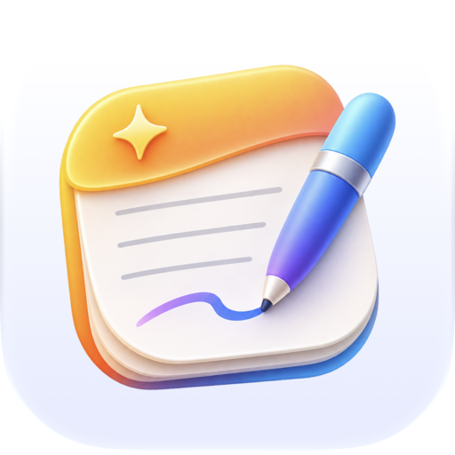
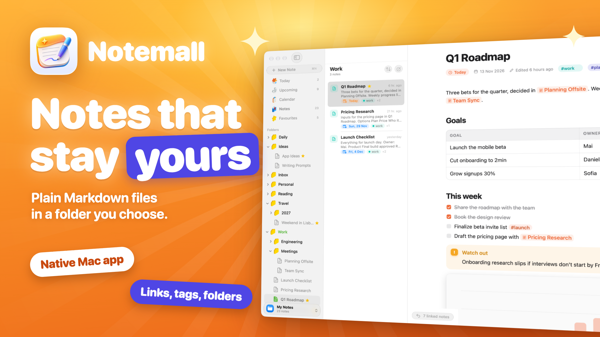

<h1 align="center">Notemall</h1>

Fast notes for Mac that stay yours: plain Markdown files in a folder you choose, with blocks, linked notes and a Today view for notes you want to see again.

<a href="https://github.com/IndieGoodies/Notemall/releases/latest/download/Notemall.dmg"><b>Download Notemall</b></a> · <a href="https://indiegoodies.gumroad.com/l/notemall">License</a> · <a href="https://indiegoodies.com">indiegoodies.com</a>

## Features

- **Your files.** Notes are Markdown files in a folder you pick. Keep it in iCloud Drive, Dropbox or Google Drive to sync across your Macs, and open the notes in any editor.
- **Blocks.** Type `/` for headings, to-dos, tables, callouts, code and images.
- **Linked notes.** Type `[[` to link a note and see every note that links back.
- **Folders and tags.** Folders and notes in the sidebar, the way they are on disk, plus tags and favourites.
- **Come back later.** Pick a day for a note and it shows up in Today. Browse by date in the calendar and keep daily notes.
- **Search or create.** Press ⌘K to find any note or start a new one.
- **Quick entry.** Capture a thought from any app with a keyboard shortcut.
- **Assistants.** Ask your notes with Apple Intelligence on your Mac, and connect Claude and other assistants through MCP.

## Requirements

- macOS 26 or later

## Updates

Notemall checks for updates on its own. You can also download the latest version from
[Releases](https://github.com/IndieGoodies/Notemall/releases/latest).

## Report an issue or request a feature

Open an issue at [github.com/IndieGoodies/Notemall/issues](https://github.com/IndieGoodies/Notemall/issues).
